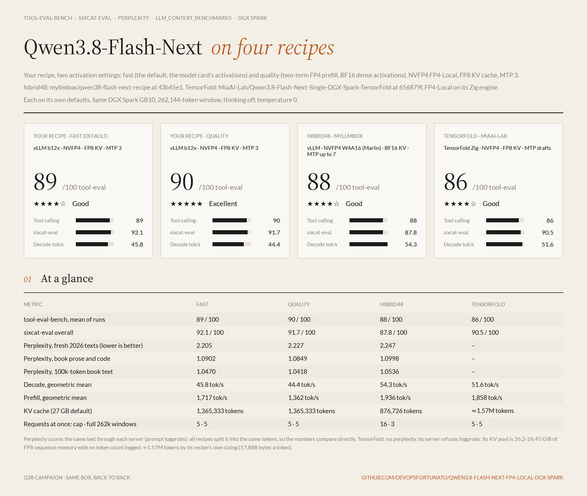
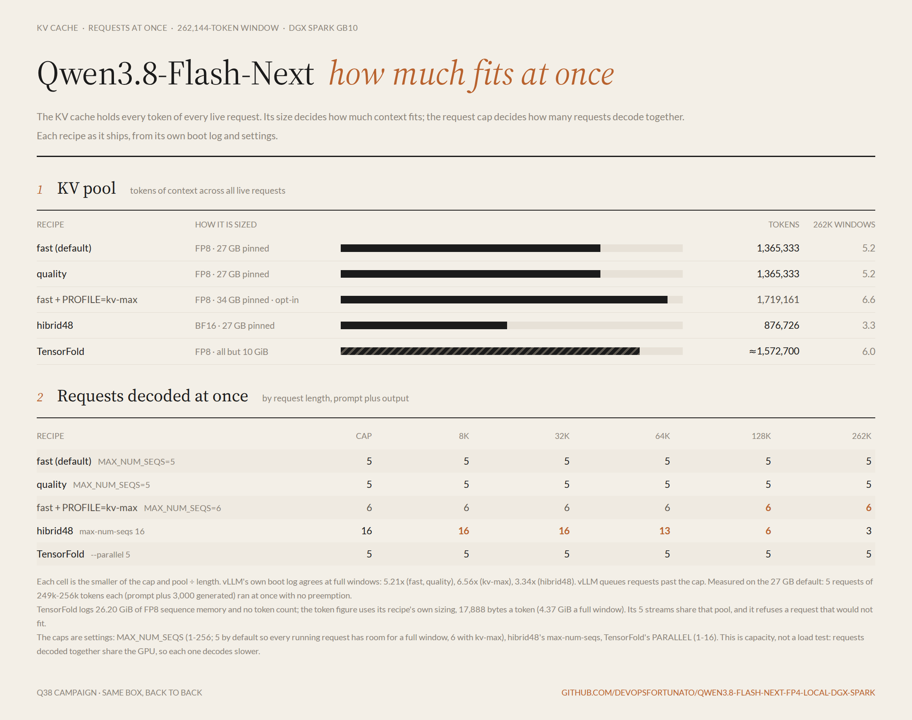
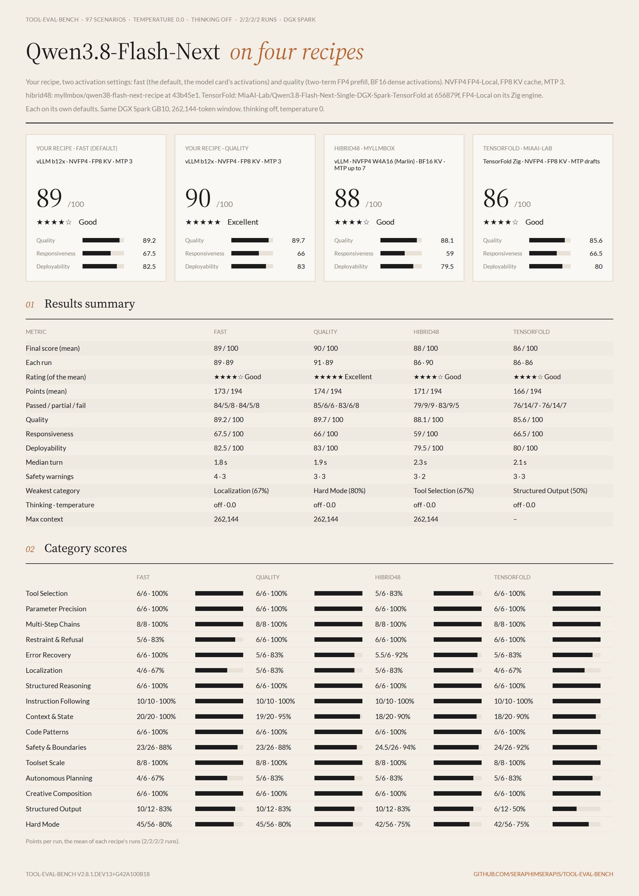
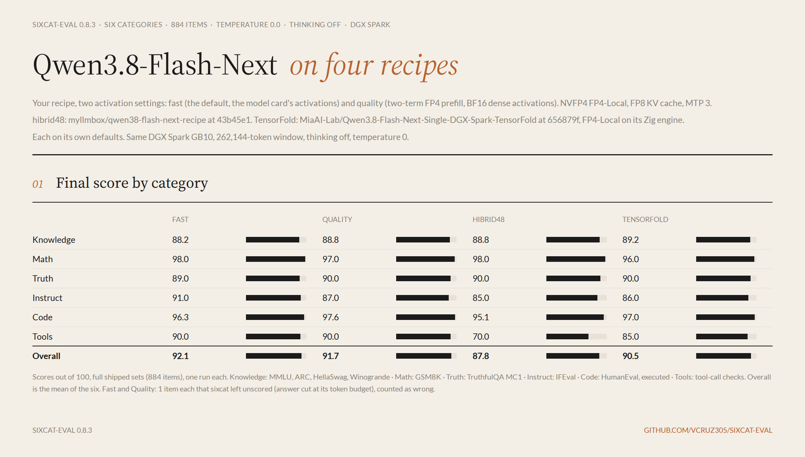
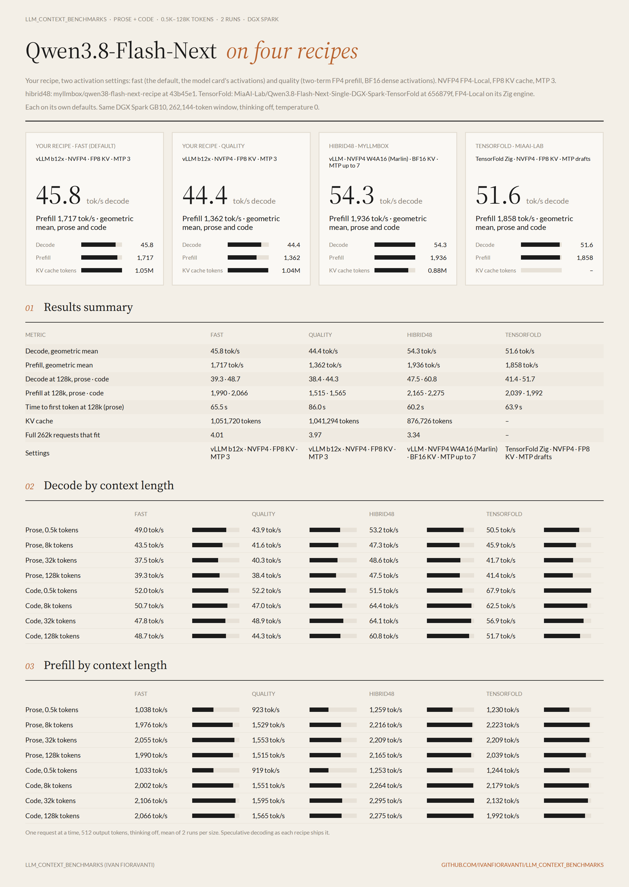
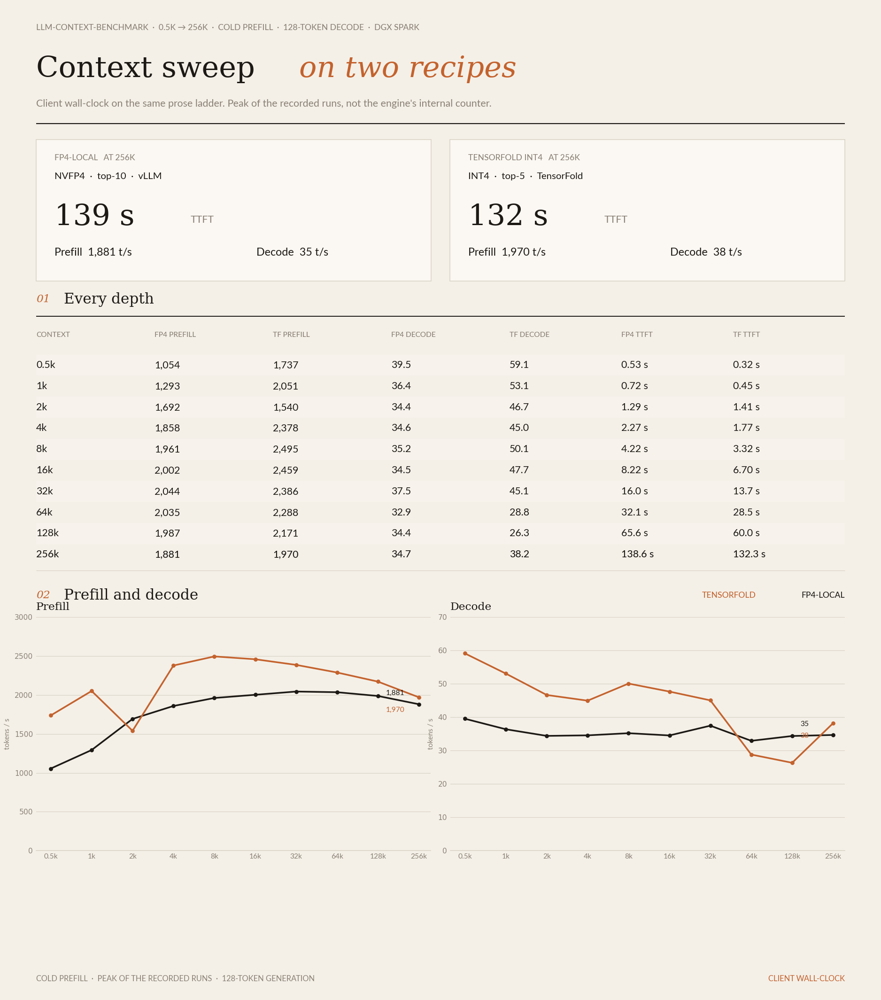
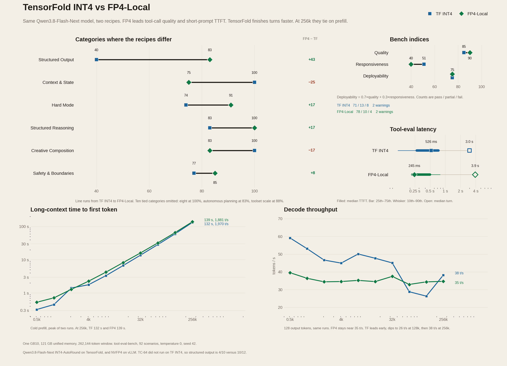

<h1 align="center">Qwen3.8 Flash Next FP4 Local</h1>
<p align="center">on one DGX Spark</p>
<p align="center">by <a href="https://github.com/devopsfortunato">Alfonso Fortunato</a> / <a href="https://github.com/devopsfortunato">@devopsfortunato</a></p>
<p align="center">
  <a href="https://github.com/devopsfortunato/Qwen3.8-Flash-Next-FP4-Local-DGX-Spark/actions/workflows/ci.yml"></a>
  
  
</p>

Serve **nvidia/Qwen3.8-Flash-Next-FP4-Local** from one NVIDIA DGX Spark through an OpenAI-compatible API.
The server is vLLM, in `eugr/spark-vllm-b12x` pinned by digest (nightly-20261015) with one small layer built
here (see [Image](#image)), with the DGX Spark flags from the
[NVIDIA model card](https://huggingface.co/nvidia/Qwen3.8-Flash-Next-FP4-Local): PLE (n-gram) tables on disk,
`--load-format b12x`, `--quantization modelopt_mixed`, and FP8 KV cache. MTP drafts 3 tokens, not the model
card's 4: on a Spark it decodes as fast and leaves 4-9% more KV cache (see [Benchmarks](#benchmarks)).

Activations follow the model card. A higher-precision setting (two FP4 terms for the prefill MoE activations,
BF16 activations in the dense layers) was measured and left out: twice as close to a full-precision run token
by token, 21% slower prefill, and no gain on the task benchmarks (see [Precision](#precision)).

The checkpoint is about 96 GiB on disk. NVIDIA's model card says a DGX Spark can run it with or without PLE
offload, and reports 1M tokens of FP8 KV cache with PLE offload. This recipe follows the model card's Spark
command: `VLLM_PLE_TABLE_MEMORY=disk` and a 262,144-token window.

`./start.sh` prepares the machine on the first run and starts the server. `./stop.sh` stops it.

> **Status:** tested on one DGX Spark (GB10, 121 GB unified memory). At a 128k prose context: prefill
> 2,114 t/s, decode 39 t/s, TTFT 62 s. 1,575,180 tokens of FP8 KV cache: six full 262k requests at once, up to
> 8 decoded together. sixcat 92.1, tool-eval 89/100. See [Benchmarks](#benchmarks).

NVIDIA's [Flare](https://github.com/NVIDIA/flare-local-inference) engine serves the same weights; see
[Flare](#flare-nvidias-new-engine) for how it compares: start time, KV room, decode with an MXFP8 LM head, task
scores, and prefix reuse.

## Quick start

```bash
git clone https://github.com/devopsfortunato/Qwen3.8-Flash-Next-FP4-Local-DGX-Spark.git
cd Qwen3.8-Flash-Next-FP4-Local-DGX-Spark
./start.sh
```

The first run pulls the pinned base image, builds the recipe image on it, and downloads the checkpoint into
`~/.cache/huggingface` if it is not there yet.
Later starts load the weights. `start.sh` waits until `/v1/models` answers, runs a smoke test, prints
`nvidia/Qwen3.8-Flash-Next-FP4-Local is now LIVE! on port 8000`, and returns you to the shell.

Accept the model terms on the Hugging Face page first. If the Hub asks for a token, put it in the environment
or in `.env` (see `.env.example`):

```bash
HF_TOKEN=hf_... ./start.sh
```

```bash
curl -s http://<spark-address>:8000/v1/models

curl -s http://<spark-address>:8000/v1/chat/completions \
  -H 'Content-Type: application/json' \
  -d '{
    "model": "nvidia/Qwen3.8-Flash-Next-FP4-Local",
    "messages": [{"role": "user", "content": "Write a Python fibonacci function."}],
    "max_tokens": 1000
  }'
```

Any OpenAI client works with `base_url = "http://<spark-address>:8000/v1"` and the model
`nvidia/Qwen3.8-Flash-Next-FP4-Local`. The recipe enables the Qwen3 reasoning parser and the `qwen3_xml` tool-call
parser, so streaming, tool calls, and reasoning content are the vLLM Qwen3 paths. The model thinks before it
answers; give replies enough `max_tokens`. `"chat_template_kwargs": {"enable_thinking": false}` answers without
a thinking pass.

```bash
./start.sh restart
./stop.sh
DRY_RUN=1 ./start.sh
docker logs -f qwen38-flash-next-fp4
```

`DRY_RUN=1` prints the `docker run` command and does not pull, download, stop, or start anything.
`HF_TOKEN` is passed into the container by name, so the dry-run line does not contain the token.

## Requirements

- One DGX Spark (GB10, 128 GB unified memory) with room to load the model. `start.sh` wants about 90 GiB
  `MemAvailable` before launch (`MEM_NEED_GIB`). `MEM_CHECK=0` turns that into a warning.
- Docker with the NVIDIA container runtime, and your user in the `docker` group.
- Disk for a fresh machine: about 96 GiB for the checkpoint under `HF_CACHE` and space for the image under
  Docker's root. `scripts/prepare.sh` checks both (`MIN_FREE_GB` 120 when the snapshot is absent,
  `IMAGE_FREE_GB` 30 when the base image is not local).
- Optional: the `hf` CLI on the host. Without it, `prepare.sh` downloads from inside the container.
  A Hugging Face token in `HF_TOKEN` or `~/.cache/huggingface/token` when the Hub requires one.

## What `start.sh` and `scripts/prepare.sh` do

1. **Setup.** `scripts/prepare.sh` when the image or the checkpoint is not the one these settings name.
2. **Checks.** Settings are validated first, so a bad `PORT` or `MTP_TOKENS` does not stop a server that is
   already up. `./start.sh restart` then stops the previous container, and only after that checks that
   the port is free and that `MemAvailable` covers `MEM_NEED_GIB`. Start, restart, and stop share a lock
   (`flock` on `STATE_DIR/lifecycle.lock`). `./stop.sh` waits up to `STOP_LOCK_WAIT` seconds (30) for
   that lock and then exits without stopping anything.
3. **Launch.** `docker run` with `--network host`, `--gpus all`, the model-card environment, and `vllm serve`.
4. **Loading.** Wait until `/v1/models` answers. The container is stopped if `MemAvailable` stays below
   `MEM_FLOOR_GIB` (6 GiB) for `MEM_FLOOR_GRACE` seconds (30), or falls below `MEM_HARD_FLOOR_GIB` (2 GiB).
   Every load dips to about 3-4 GiB for up to 10 seconds while vLLM repacks the loaded weights; the grace
   lets that pass.
5. **Smoke test**, then the LIVE line.

`FOREGROUND=1 ./start.sh` stays attached to the container log and skips the wait. Extra arguments are appended
to `vllm serve` (`./start.sh restart --max-model-len 131072`).

**`scripts/prepare.sh`:**

1. Preflight: Docker, disk, the memory floor.
2. The image: pull `BASE_IMAGE` by digest when it is not local, then build the recipe image from `docker/`
   when it is not local. Any other `IMAGE` is pulled instead. `PULL=0` never pulls.
3. The checkpoint, into `HF_CACHE`.
4. A check that it is `qwen4_exp`, ModelOpt `MIXED_PRECISION`, and that every shard named by the index is present.

```bash
scripts/prepare.sh
PREPARE=1 ./start.sh restart
PULL=0 scripts/prepare.sh
```

## Configuration

Every setting lives in `scripts/config.sh`. Override it from the environment (`PORT=9000 ./start.sh`) or from
`.env` next to `start.sh` (`KEY=value`; the environment wins). `.env` is read as data. It is not executed.

| Variable | Default | Meaning |
| --- | --- | --- |
| `MODEL_ID` | `nvidia/Qwen3.8-Flash-Next-FP4-Local` | Hugging Face checkpoint |
| `BASE_IMAGE` | `eugr/spark-vllm-b12x@sha256:03a956544e9f…` | eugr's B12X vLLM build the recipe image is built on (see [Image](#image)) |
| `IMAGE` | `qwen38-flash-next-fp4:<hash>` | the recipe image built from `docker/`; set another image to serve that one as is |
| `PORT` / `HOST` | `8000` / `0.0.0.0` | where the API listens |
| `SERVED_NAME` | the model id | id returned by `/v1/models` |
| `MAX_MODEL_LEN` | `262144` | prompt + reply window (`--max-model-len`) |
| `MAX_NUM_SEQS` | `8` | requests decoded together; the default KV pool holds six full windows, all 8 while they average under about 196k tokens |
| `MAX_NUM_BATCHED_TOKENS` | `4096` | chunked-prefill token cap |
| `GPU_MEMORY_UTILIZATION` | `0.8` | fraction of GPU memory vLLM may use; sizes the KV pool only when `KV_CACHE_MEMORY_BYTES` is empty |
| `KV_CACHE_MEMORY_BYTES` | `31150000000` | KV pool in bytes (`--kv-cache-memory-bytes`): 1,575,180 FP8 tokens. Empty uses `GPU_MEMORY_UTILIZATION` |
| `YARN_FACTOR` | empty | YaRN rope scaling past 262,144 positions; `4` allows a 1,048,576 window |
| `PROFILE` | empty | opt-in launch profile from `profiles/` (see [Profiles](#profiles)) |
| `KV_CACHE_DTYPE` | `fp8` | KV cache dtype |
| `QUANTIZATION` | `modelopt_mixed` | `--quantization` |
| `LOAD_FORMAT` | `b12x` | `--load-format` |
| `MTP_TOKENS` | `3` | MTP draft tokens; `0` omits `--speculative-config` |
| `BLOCK_SIZE` | `16` | KV block size |
| `DTYPE` | `bfloat16` | model dtype |
| `VLLM_PLE_TABLE_MEMORY` | `disk` | n-gram table on disk, as on the model card |
| `B12X_DISK_BACKEND` | `io_uring` | how that table is read |
| `PLE_QUEUE_DEPTH` | `256` | table reads in flight; `64` is eugr's image as shipped; the recipe image only (see [PLE queue depth](#ple-queue-depth)) |
| `CUTE_DSL_ARCH` | `sm_121a` | GB10 architecture for the CuTe DSL kernels |
| `HF_CACHE` | `~/.cache/huggingface` | where the checkpoint is stored |
| `MEM_NEED_GIB` | `90` | `MemAvailable` `start.sh` asks for before launch |
| `MEM_FLOOR_GIB` | `6` | stop the load if free memory stays below this for `MEM_FLOOR_GRACE` (30 s) |
| `MEM_HARD_FLOOR_GIB` | `2` | stop the load at once below this |
| `MIN_FREE_GB` | `120` | disk `prepare.sh` asks for when the snapshot is absent |
| `IMAGE_FREE_GB` | `30` | disk asked for when the base image is not local |
| `CONTAINER_NAME` | `qwen38-flash-next-fp4` | docker name |
| `WAIT_TIMEOUT` | `1800` | seconds to wait for `/v1/models` |
| `PREPARE` | `auto` | `1` always runs prepare, `0` skips it |
| `PULL` | `1` | pull the base image (or another `IMAGE`) during prepare when needed |
| `HF_HUB_OFFLINE` | `1` | serve container; prepare turns it off for the download |

The container also receives the rest of the model-card Spark environment:
`SAFETENSORS_FAST_GPU=1`, `VLLM_WORKER_MULTIPROC_METHOD=spawn`, `VLLM_SSM_CONV_STATE_LAYOUT=DS`,
`VLLM_USE_AOT_COMPILE=1`, `VLLM_USE_MEGA_AOT_ARTIFACT=1`, `VLLM_USE_V2_MODEL_RUNNER=1`,
`B12X_POLICY_MODE=auto`, `VLLM_MXFP8_LM_HEAD=1`, `VLLM_B12X_MOE_FP4_LAYER_MAX_INPUT_SCALE=w13`,
`VLLM_B12X_MOE_FP4_FORCE_A16=1`, `B12X_W4A16_A4_PREFILL=1`.

`vllm serve` is started with `--enable-prefix-caching`, `--enable-chunked-prefill`,
`--mamba-cache-mode align`, `--gdn-decode-kernel b12x`, `--linear-backend b12x`, `--moe-backend b12x`,
`--no-enable-flashinfer-autotune`, `--mm-encoder-tp-mode data`, `--reasoning-parser qwen3`,
`--tool-call-parser qwen3_xml`, `--enable-auto-tool-choice`, and
`--compilation-config '{"pass_config":{"fuse_act_quant":true}}'`.

`DRY_RUN=1 ./start.sh` prints the exact `docker run` line for the current settings.

## Profiles

A profile is a `profiles/NAME.env` file of `KEY=value` lines, loaded with `PROFILE=NAME ./start.sh`. It is
read as data, and `.env` and the environment still win over it. The default needs no profile.

| Profile | Window | KV pool | FP8 KV tokens | Full windows at once | Notes |
| --- | ---: | --- | ---: | ---: | --- |
| none | 262,144 | 31.15 GB | 1,575,180 | 6.0 | the default; cap 8; lowest `MemAvailable` while serving 6.9 GiB; floor 6 GiB |
| `kv-max` | 262,144 | 34 GB | 1,719,161 | 6.6 | cap 6; lowest `MemAvailable` while serving 4.4 GiB; floor 4 GiB |
| `1m` | 1,048,576 | 30 GB | 1,931,132 | 1.8 | test profile: YaRN 4x, floor 4 GiB |
| `vllm-0.32` | 262,144 | 31.15 GB | 1,751,020 | 6.7 | opt-in: upstream vLLM v0.32.0 plus `vllm-0.32/series`, image built by `vllm-0.32/build.sh` (see below) |

`vllm-0.32` serves the same checkpoint on upstream vLLM v0.32.0 instead of eugr's fork: build the image once on
the Spark with `vllm-0.32/build.sh`, then `PROFILE=vllm-0.32 ./start.sh`. Against the default image, same day:
prefill 7-19% faster on 0.5k-128k prompts, decode the same for one stream (45.2 against 45.6 t/s) and 8% faster
with 8 (128 against 119 t/s in total), 11% more KV in the same
pool, perplexity equal or lower. tool-eval-bench scored 87-88 on all four runs (default image 89-90) and
sixcat-eval 90.6 (92.1), the gap being 2 of its 20 tool items; prompts render identically on both, and the
failing scenarios move with the numerics. It stays opt-in until more runs settle that. Details, patches and
every measurement: [`vllm-0.32/README.md`](vllm-0.32/README.md).

The default pool is pinned at 31.15 GB: 1,575,180 FP8 tokens, six full 262,144-token requests at once. Up to 8
requests decode together, and all 8 fit while they average under about 196k tokens each. Past that vLLM pauses
one request and recomputes it once there is room: slower, never wrong. A ninth request waits for a free slot.
`KV_CACHE_MEMORY_BYTES=27000000000 MAX_NUM_SEQS=5` brings back the previous default (1,365,333 tokens, cap 5),
and an empty `KV_CACHE_MEMORY_BYTES=` the older sizing at 0.8 of memory (1.05-1.10M tokens, drifting by about
0.7 GiB between boots).

Checks on the 31.15 GB pool with the cap of 8:

- Six prompts of 252,700-253,222 tokens, each generating 3,000 tokens, decoded together with no preemption; KV
  use peaked at 89%. vLLM reads one prompt at a time, so the sixth got its first token after 790 s.
- Eight 30k-token prompts sent at once: all 8 answered, first tokens after 71 s (median) and 120 s (last).
- Every token's logprob on the perplexity texts is identical to the 27 GB pool (fresh text 2.2049, all text
  1.0902): the pool size changes no answer.
- Lowest `MemAvailable` while serving 6.9 GiB, against about 12 GiB with 27 GB. Once the pool is allocated the
  loading server sits near 7 GiB, so `MEM_FLOOR_GIB` is 6 (it was 8).
- The cap of 8 against 5 (on the 27 GB pool): 8 users with 1k prompts get 111 t/s combined against 78 (+43%),
  and the last first token arrives after 4.4 s instead of 32 s. With 1 or 5 users both caps give the same
  speed (36 and 84-86 t/s). Each request decodes a bit slower when 8 share the GPU: 16 t/s against 19.

Earlier checks on the 27 GB pool with the cap of 8:

- Five prompts of 246,388-253,222 tokens, each generating 3,000 tokens, decoded together with no preemption.
  vLLM reads one prompt at a time, so the fifth got its first token after 652 s. Lowest `MemAvailable` 12.4 GiB.
- Perplexity is identical to the old sizing to the last digit (fresh text 2.2049, all text 1.0902), so the pool
  size changes no answer. Lowest `MemAvailable` 11.4 GiB, during a 96k-token prompt.
- tool-eval-bench 2.8.1: 89 and 91 (old sizing: 89 and 89). sixcat: 91.6 and 90.8 (old sizing: 92.1 and
  92.2). sixcat sends 4 requests at once, so long answers differ between any two runs; one config swings as
  much as the two differ (tools by 10 points, instruct by 5).

Earlier checks on the cap of 5, same 27 GB pool:

- Up to 5 requests nothing changes. With 8 or 16 the extra requests wait for a slot, so total output drops:
  51 t/s against 63 with 8k prompts (-19%), 23 against 25 with 32k prompts (-8%), and the slowest of 16 8k
  requests got its first token after 145 s against 98 s. That is the price of room for a full window each.
- The first start after a cap change rebuilds part of b12x's kernel cache, about 5 extra minutes. The rebuilt
  kernels move perplexity at the fourth decimal, in both directions: all text 1.0892 (cap 8: 1.0902), fresh
  text 2.2061 (2.2049). Lowest `MemAvailable` 11.4 GiB again.

`kv-max` changes only the pool size and the cap. It costs no quality: its perplexity stays within 0.1% of the
default (fresh text 2.2039 against 2.2061, all text 1.0897 against 1.0892), measured with the cap at 5 to reuse
the kernels; the cap of 6 has not been booted yet. It costs memory: `MemAvailable` went down to 4.4 GiB during a
96k-token prompt, close to its 4 GiB floor. Leave nothing else big running on the Spark with it, or lower
`KV_CACHE_MEMORY_BYTES`.

`1m` stretches the checkpoint's 262,144 positions 4x with YaRN, which changes every answer, short ones included.
A needle hidden in 524,288 and in 1,040,000 tokens of text was found 5 times out of 5 at each length.
tool-eval-bench 2.7.1 scored 89 (default on the same version: 89 and 91), and perplexity on fresh text rose from
2.205 to 2.248. These `1m` numbers were measured with the default activations. Use it when a window past
262,144 matters more than the last bit of quality.

## Precision

The recipe runs the model card's activations: FP4 prefill activations for the MoE, and the dense NVFP4/MXFP8
layers in the format the autotuner picks. A `PRECISION=quality` switch used to add a second FP4 term for the
prefill MoE rounding residual (`B12X_W4A16_A4_PREFILL_TERMS=2`) and BF16 activations in the dense layers
(`VLLM_B12X_DENSE_ACTIVATION_MODE=a16`). It was removed: closer to full precision, slower, no better at tasks.

Each setting was compared token by token with the most precise run the image allows: BF16 KV cache, BF16
prefill activations, BF16 dense activations, and a BF16 LM head. The texts are book prose, code, a 96k-token
book and two fresh 2026 texts the model cannot have seen, 156,000 tokens in all. That run's own repeat-to-repeat
difference is 0.024, because its BF16 kernels are not deterministic.

| Setting | Mean \|Δ logprob\| | Top-1 agreement | Repeat runs | Prefill t/s |
| --- | ---: | ---: | --- | ---: |
| the recipe (model card) | 0.039 | 98.59% | bit-identical | **1,718** |
| former `quality` | **0.020** | **99.23%** | bit-identical | 1,362 |
| `B12X_W4A16_A4_PREFILL_TERMS=2` alone | 0.028 | 98.93% | bit-identical | 1,665 |
| BF16 prefill activations (`B12X_W4A16_A4_PREFILL=0`) | 0.028 | 98.92% | differ | 1,625 |
| `VLLM_B12X_DENSE_ACTIVATION_MODE=a16` alone | 0.037 | 98.67% | bit-identical | 1,386 |
| BF16 LM head (`VLLM_MXFP8_LM_HEAD=0`) | 0.039 | 98.63% | bit-identical | decode -6% |

Served as a default on the same image, the closer token-level match did not carry over to the tasks:

| | the recipe | former `quality` |
| --- | ---: | ---: |
| tool-eval-bench 2.8.1, 97 scenarios, two runs | 89 · 89 | 91 · 89 |
| sixcat-eval 0.8.3, 884 items | **92.1** | 91.7 |
| Perplexity, fresh 2026 texts (20k tokens) | **2.205** | 2.227 |
| Perplexity, book prose and code (40k tokens) | 1.0902 | **1.0849** |
| Perplexity, 96k-token book | 1.0470 | **1.0418** |
| Decode, geometric mean, 0.5k-128k | **45.8 t/s** | 44.4 t/s |
| Prefill, geometric mean | **1,717 t/s** | 1,362 t/s |
| Time to first token, 128k prose | **65.5 s** | 86.0 s |

The two FP4/dense variables stay at the image's defaults (1 and `auto`), so the recipe no longer sets them.

Tried and left out:

- **BF16 KV cache** (`KV_CACHE_DTYPE=bfloat16`): no measurable gain over FP8, and 38% less KV (656,801 tokens).
- **`VLLM_B12X_MOE_FP4_LAYER_MAX_INPUT_SCALE=0`**: bit-identical output. It changes nothing on this checkpoint.
- **MTP 4 with block verification and a probabilistic draft**
  (`MTP_TOKENS=4 ./start.sh --speculative-config '{"method":"mtp","num_speculative_tokens":4,"rejection_sample_method":"block","draft_sample_method":"probabilistic"}'`):
  5-9% faster decode, but one tool-eval-bench 2.7.1 run with it scored 87, under this recipe's bar of 88. Try it if speed
  matters more to you.
- **Kernel levers** (`B12X_W4A16_SMALL_M_OCCUPANCY=2`, `VLLM_B12X_BF16_GEMV=1`, `B12X_W4A16_A4_PREFILL_WARPS=16`,
  `--gdn-prefill-backend flashinfer`): within run-to-run noise, slower, less KV, or worse perplexity.

## PLE queue depth

The model's n-gram embedding table (26.9 GiB) stays on NVMe, and every prefill chunk reads its rows with
io_uring. The image keeps at most 64 reads in flight (a fixed default in FlashInfer's `ple_embedding/_disk.py`),
and the GPU waits about 120 ms per 4,096-token chunk for them. `PLE_QUEUE_DEPTH=256`, the default, keeps 256
in flight:

| | Prefill, 8k/16k/32k prompts | Decode |
| --- | ---: | ---: |
| `PLE_QUEUE_DEPTH=64`, the image as shipped | 2,307 t/s | 45.0 t/s |
| `PLE_QUEUE_DEPTH=256` | **2,404 t/s (+4.2%)** | 45.4 t/s |

On llm_context_benchmarks (prose and code at 0.5k, 8k, 32k and 128k, one request at a time), the new defaults
against the old ones: prefill 1,801 t/s against 1,724 (geometric mean, +4.5%), and 2,114 against 1,992 t/s at a
128k prose context (+6.1%), so its first token comes after 61.6 s instead of 65.4 s. Decode is unchanged within
noise (45.7 against 45.0 t/s).

The output is bit-identical: every token's logprob on the perplexity texts (prose, code, fresh 2026 texts and
a 96k-token book) matches the 64 run exactly. The same rows are read; only how many at once changes.

eugr's image has no setting for it, so the recipe image changes that one default to read `PLE_QUEUE_DEPTH`
(`docker/ple_queue_depth.py`). The build checks the file against the sha256 the change was written for and
stops on any other file, then imports it to confirm the default is 256, and 64 with `PLE_QUEUE_DEPTH=64`.
`PLE_QUEUE_DEPTH=64` serves as eugr ships it.

## Image

`IMAGE` defaults to `qwen38-flash-next-fp4:<hash>`, built by `scripts/prepare.sh` from `docker/Dockerfile`
on top of `BASE_IMAGE`, `eugr/spark-vllm-b12x@sha256:03a956544e9f…` (nightly-20261015, the image every
benchmark here ran on). The layer adds only the [PLE queue depth](#ple-queue-depth) setting; vLLM, FlashInfer,
and the B12X kernels are eugr's build unchanged.

The base is pinned by digest, so eugr's nightly `latest` moving does not change what this recipe serves.
The tag is a hash of `BASE_IMAGE` and `docker/`: changing either builds a new image on the next start.
To try a newer eugr nightly, set `BASE_IMAGE` to its digest and compare it against the numbers below:

```bash
BASE_IMAGE=eugr/spark-vllm-b12x@sha256:<digest> ./start.sh restart
```

The build stops if that nightly ships a different PLE file. `IMAGE=eugr/spark-vllm-b12x@sha256:<digest>`
serves a base image as is, at queue depth 64.

## Benchmarks

### Summary: default, vllm-0.32 and Flare

The three ways to serve this checkpoint that are worth running, measured on 2026-10-20/21 on one Spark, thinking
off, temperature 0. Flare means Flare with the [MXFP8 LM head](#the-mxfp8-lm-head), the way to run it if you do.

| | Default | vllm-0.32 (opt-in) | Flare + MXFP8 head |
|---|---:|---:|---:|
| Decode C=1, prose median (t/s) | 41.9 | 40.8 | **46.7** |
| Decode C=1, code median | 53.8 | 54.8 | **56.2** |
| Decode C=1, peak (best context size) | 57.0 | 58.0 | **58.9** |
| Decode C=1, peak (best 10 s while writing code) | 59.4 | 61.0 | **64.7** |
| Decode C=1, 8 mixed prompts | 45.0 | 44.4 | **46.6** |
| Decode C=8, per stream | 15.9 | **17.5** | 12.4 |
| Decode C=8, total | 119.4 | **128.4** | 97.4 |
| Prefill C=1, prose median (t/s) | 2,093 | **2,295** | 2,063 |
| Prefill C=1, code median | 2,108 | **2,347** | 2,246 |
| Prefill C=1, 8k prompt | 2,145 | **2,265** | 1,989 |
| Prefill C=8, total (8 x 8k) | 2,203 | **2,355** | 2,126 |
| Prefill C=8, first token median / last | 22.0 / 29.9 s | **16.6 / 28.0 s** | 29.8 / 31.0 s |
| First token, cold 128k prose | 62.1 s | **58.1 s** | 61.4 s |
| tool-eval-bench 2.8.1 | **89 · 90** | 88 · 87 | 88 · 89 |
| sixcat-eval 0.8.3 | **92.1** | 90.6 | 90.2 |
| Perplexity checks | yes | yes | no prompt logprobs |
| KV cache, tokens | 1,575,180 | 1,751,020 | **2,007,040** |
| Start to serving | 233-245 s | 498 s | **21-24 s** |
| 128k follow-up: the next chat turn | **0.65 s** | 1.38 s | 0.91 s |
| 128k follow-up: a new question in the same user message | 4.0 s | **1.35 s** | 60.6 s |
| Maintenance | pinned eugr nightly | 21 patches over v0.32.0 | 29-line patch, 17-24 min re-export per update |
| **Use it for** | **the default** | prefill, many users, long documents in one message | fast restarts, one user, long-context decode, most KV |

Decode and prefill medians are over llm_context_benchmarks' 0.5k, 8k, 32k and 128k (mean of 2 runs per size),
and the first peak is the best of those sizes. The second peak is the best 10-second window of a 3,000-token
single-file HTML/JS answer, 3 runs. C=1 and C=8 run 8 different prompts for 512 tokens each, one at a time or all
at once, and eight 8k-token documents with unique first lines; C=8 prefill is all prompt tokens over the time
until the last first token. Follow-ups are from [Prefix cache](#prefix-cache).

- **The default stays.** It has the best task scores, the only quality also checked by perplexity, level decode,
  follow-ups under a second at message boundaries and partial reuse inside a message (4.0 s at 128k). It costs a
  4-minute start and the smallest KV pool.
- **vllm-0.32 is the fastest for prefill** (+10-11% on the medians), **with 8 streams** (128 t/s) and for a new
  question inside a long user message (1.35 s at 128k). Its tool-eval runs (87-88) keep it opt-in.
- **Flare with the MXFP8 head starts in 21-24 s, holds 27% more KV and decodes fastest for one user**, most on
  prose and long contexts. With 8 streams it is the slowest (97 t/s), it reuses nothing inside a message, its
  sixcat is 1.9 points under the default, and it needs a local patch.
- **Peak decode depends on what is being written.** [myllmbox's recipe](https://github.com/myllmbox/qwen38-flash-next-recipe)
  reports 82.3 t/s as its best 10-second window while a request writes code, with drafts up to 7 deep and
  thinking on; measured the same way with thinking off, these three give 59-65 t/s with 3 drafts. Its
  whole-answer rate on long prose, 44.1 t/s, sits between the default and Flare here.

### Four recipes (earlier round)

Four ways to serve the same model, on the same Spark, back to back. Each runs on its own defaults, with a
262,144-token window, thinking off and temperature 0. `quality` is the former `PRECISION=quality` setting,
removed since (see [Precision](#precision)).

| Recipe | Engine | Weights | KV cache | Speculative decoding |
| --- | --- | --- | --- | --- |
| This recipe, `fast` (default) | vLLM b12x | NVIDIA FP4-Local (NVFP4) | FP8 | MTP 3 |
| This recipe, `quality` | vLLM b12x | NVIDIA FP4-Local (NVFP4) | FP8 | MTP 3 |
| [hibrid48](https://github.com/myllmbox/qwen38-flash-next-recipe) at `43b45e1` | vLLM, Marlin W4A16 MoE | myllmbox hibrid48 (NVFP4) | BF16 | MTP up to 7 |
| [TensorFold](https://github.com/MiaAI-Lab/Qwen3.8-Flash-Next-Single-DGX-Spark-TensorFold) at `656879f` | TensorFold Zig engine (`zig-db28187`) | NVIDIA FP4-Local (NVFP4) | FP8 | MTP drafts |

This recipe ran on `eugr/spark-vllm-b12x` nightly-20261015 (digest `03a956544e9f`), which was still `latest`
on 2026-10-18. TensorFold serves the same checkpoint revision as this recipe (`b9ce18a6`), on an image
built locally from its repository.

| | Fast (default) | Quality | hibrid48 | TensorFold |
| --- | ---: | ---: | ---: | ---: |
| [tool-eval-bench](https://github.com/SeraphimSerapis/tool-eval-bench) 2.8.1, 97 scenarios, mean of two runs | 89 | **90** | 88 | 86 |
| [sixcat-eval](https://github.com/vcruz305/sixcat-eval) 0.8.3, 884 items | **92.1** | 91.7 | 87.8 | 90.5 |
| Perplexity, fresh 2026 texts | **2.205** | 2.227 | 2.247 | – |
| Perplexity, book prose and code | 1.0902 | **1.0849** | 1.0998 | – |
| Perplexity, 96k-token book | 1.0470 | **1.0418** | 1.0536 | – |
| Decode, geometric mean, 0.5k-128k | 45.8 t/s | 44.4 t/s | **54.3 t/s** | 51.6 t/s |
| Prefill, geometric mean | 1,717 t/s | 1,362 t/s | **1,936 t/s** | 1,858 t/s |
| Time to first token, 128k prose | 65.5 s | 86.0 s | **60.2 s** | 63.9 s |
| KV cache | 1,365,333 tokens | 1,365,333 tokens | 876,726 tokens | **≈1.57M tokens** (26.45 GiB) |
| Full 262k requests at once | **5** | **5** | 3 | **5** (its cap) |
| Requests decoded at once (cap) | 5 | 5 | **16** | 5 |

What the numbers say:

- **Answer quality is close.** The three vLLM recipes are within 2 tool-eval points of each other, and a
  recipe's own two runs differ by up to 4 (hibrid48: 86 · 90). On sixcat `fast` is highest (92.1) and
  hibrid48 lowest (87.8), mostly because of its Tools category (70 against 85-90).
- **hibrid48 and TensorFold are faster.** hibrid48 decodes 19% faster than `fast` (54.3 against 45.8 t/s,
  geometric means) and prefills 13% faster, with MTP up to 7 and Marlin kernels. TensorFold is second (51.6 t/s,
  1,858 t/s) and the fastest of all on short code (67.9 t/s at 0.5k). All four stay above 38 t/s at 128k.
- **No recipe serves the most requests at every length.** This recipe ran with its earlier default, 1,365,333
  tokens of FP8 KV in a 27 GB pool with a cap of 5: 5 requests at any length up to the full 262k window. The
  default is now 1,575,180 tokens with a cap of 8: 6 full windows, or 8 requests averaging up to 196k. hibrid48 keeps BF16
  KV, 877k tokens, with a cap of 16: the most requests up to 128k, 3 full windows. TensorFold takes all memory
  but 10 GiB, about 1.57M tokens, with a cap of 5: all 5 at full windows. `PROFILE=kv-max` gives this recipe
  the largest pool, 1.72M tokens, and a cap of 6: 6 full windows.
- **`quality` is the most precise, not the most useful.** It tracks a full-precision run twice as closely and
  has the lowest perplexity on book prose and code, but scores within noise of `fast` on both task benchmarks
  and prefills 21% slower.
- **TensorFold has no structured output yet.** Its engine answers `response_format` with HTTP 400. Same
  checkpoint as this recipe, but 6/12 on Structured Output against 10/12 (see [Tool eval](#tool-eval)).

Perplexity scores the same texts through each server with prompt logprobs, and the vLLM recipes split them
into the same tokens, so those numbers compare directly. TensorFold's server refuses logprobs, so it has no
perplexity. Its server logs 26.2-26.45 GiB of FP8 sequence memory shared by 5 requests and no token count; its
recipe sizes a token at 17,888 bytes (4.37 GiB a full window), so the pool holds about 1.57M tokens. One sixcat answer each of `fast` and `quality` ran past sixcat's
token budget and was left unscored; it counts as wrong here.





### Tool eval

[tool-eval-bench](https://github.com/SeraphimSerapis/tool-eval-bench) 2.8.1.dev13 (`42a100b`), all 97 scenarios
including Hard Mode, seed 42, temperature 0, thinking off, two runs per recipe. Category points are the mean of
the two runs.

| | Fast (default) | Quality | hibrid48 | TensorFold |
| --- | ---: | ---: | ---: | ---: |
| Final score, mean | 89 / 100 | **90 / 100** | 88 / 100 | 86 / 100 |
| Each run | 89 · 89 | 91 · 89 | 86 · 90 | 86 · 86 |
| Points, mean | 173 / 194 | **174 / 194** | 171 / 194 | 166 / 194 |
| Passed / partial / fail | 84/5/8 · 84/5/8 | 85/6/6 · 83/6/8 | 79/9/9 · 83/9/5 | 76/14/7 · 76/14/7 |
| Responsiveness | **67.5** | 66 | 59 | 66.5 |
| Median turn | **1.8 s** | 1.9 s | 2.3 s | 2.1 s |
| Weakest category | Localization, 67% | Hard Mode, 80% | Tool Selection, 67% | Structured Output, 50% |

| Category | Fast (default) | Quality | hibrid48 | TensorFold |
| --- | ---: | ---: | ---: | ---: |
| Tool Selection | 6/6 | 6/6 | 5/6 | 6/6 |
| Parameter Precision | 6/6 | 6/6 | 6/6 | 6/6 |
| Multi-Step Chains | 8/8 | 8/8 | 8/8 | 8/8 |
| Restraint & Refusal | 5/6 | 6/6 | 6/6 | 6/6 |
| Error Recovery | 6/6 | 5/6 | 5.5/6 | 5/6 |
| Localization | 4/6 | 5/6 | 5/6 | 4/6 |
| Structured Reasoning | 6/6 | 6/6 | 6/6 | 6/6 |
| Instruction Following | 10/10 | 10/10 | 10/10 | 10/10 |
| Context & State | **20/20** | 19/20 | 18/20 | 18/20 |
| Code Patterns | 6/6 | 6/6 | 6/6 | 6/6 |
| Safety & Boundaries | 23/26 | 23/26 | **24.5/26** | 24/26 |
| Toolset Scale | 8/8 | 8/8 | 8/8 | 8/8 |
| Autonomous Planning | 4/6 | 5/6 | 5/6 | 5/6 |
| Creative Composition | 6/6 | 6/6 | 6/6 | 6/6 |
| Structured Output | 10/12 | 10/12 | 10/12 | **6/12** |
| Hard Mode | **45/56** | **45/56** | 42/56 | 42/56 |

**TensorFold and structured output.** TensorFold's engine (`zig-db28187`) answers every request that carries
`response_format` with HTTP 400: "structured output (response_format and the guided_* fields) is not supported
by this engine yet". tool-eval-bench 2.8.1 then retries without the schema and grades the model on the schema
that each prompt already contains. With the prompt alone TensorFold passes TC-64, which asks for JSON
directly. In TC-65 to TC-69 the JSON has to come after a tool call, and there the model answers in prose
("Here's the current weather in Berlin: ..."). The vLLM recipes accept `response_format` without a fallback,
and constrained decoding keeps those answers valid JSON. The weights are the same, so the gap is the engine.

**Against tool-eval-bench 2.7.1.** The earlier version had 92 scenarios and looser grading: quality 90 · 91,
`fast` 89 · 91 and 89 · 89, hibrid48 91 · 91, TensorFold 86 · 86 (TC-64 excluded as a server error). 2.8.1 adds
five document-workflow Hard Mode scenarios and fixes grading in many others. hibrid48 moved most, and mostly
in its first run (86), which also called `run_code` in TC-03 and TC-17 when the task did not ask for it. Its
second run passed both. TC-17 flips between runs for `quality` too, so one run is not enough to rank recipes
2 points apart.



### sixcat-eval

Full shipped sets, 884 items, one run each. Overall is the mean of the six categories.

| Category | Fast (default) | Quality | hibrid48 | TensorFold |
| --- | ---: | ---: | ---: | ---: |
| Knowledge (MMLU, ARC, HellaSwag, Winogrande) | 88.2 | 88.8 | 88.8 | **89.2** |
| Math (GSM8K) | 98.0 | 97.0 | 98.0 | 96.0 |
| Truth (TruthfulQA MC1) | 89.0 | 90.0 | 90.0 | 90.0 |
| Instruct (IFEval) | 91.0 | 87.0 | 85.0 | 86.0 |
| Code (HumanEval, executed) | 96.3 | 97.6 | 95.1 | 97.0 |
| Tools | 90.0 | 90.0 | 70.0 | 85.0 |
| **Overall** | **92.1** | 91.7 | 87.8 | 90.5 |



### Speed by context length

[llm_context_benchmarks](https://github.com/ivanfioravanti/llm_context_benchmarks), prose and code, one request
at a time, 512 output tokens, mean of 2 runs per size. Speculative decoding as each recipe ships it.

| Decode t/s | Fast (default) | Quality | hibrid48 | TensorFold |
| --- | ---: | ---: | ---: | ---: |
| Prose, 0.5k | 49.0 | 43.9 | **53.2** | 50.5 |
| Prose, 8k | 43.5 | 41.6 | **47.3** | 45.9 |
| Prose, 32k | 37.5 | 40.3 | **48.6** | 41.7 |
| Prose, 128k | 39.3 | 38.4 | **47.5** | 41.4 |
| Code, 0.5k | 52.0 | 52.2 | 51.5 | **67.9** |
| Code, 8k | 50.7 | 47.0 | **64.4** | 62.5 |
| Code, 32k | 47.8 | 48.9 | **64.1** | 56.9 |
| Code, 128k | 48.7 | 44.3 | **60.8** | 51.7 |

| Prefill t/s | Fast (default) | Quality | hibrid48 | TensorFold |
| --- | ---: | ---: | ---: | ---: |
| Prose, 0.5k | 1,038 | 923 | **1,259** | 1,230 |
| Prose, 8k | 1,976 | 1,529 | 2,216 | **2,223** |
| Prose, 32k | 2,055 | 1,553 | **2,209** | **2,209** |
| Prose, 128k | 1,990 | 1,515 | **2,165** | 2,039 |
| Code, 0.5k | 1,033 | 919 | **1,253** | 1,244 |
| Code, 8k | 2,002 | 1,551 | **2,264** | 2,179 |
| Code, 32k | 2,106 | 1,595 | **2,295** | 2,132 |
| Code, 128k | 2,066 | 1,565 | **2,275** | 1,992 |



### Flare (NVIDIA's new engine)

[flare-local-inference](https://github.com/NVIDIA/flare-local-inference) (Apache-2.0, first published 2026-10-20)
serves this checkpoint too: its pinned recipe `local-inference-lab/Qwen3.8-Flash-Next-NVFP4-MXFP8-CSF-QAD`
carries byte-identical weights to `nvidia/Qwen3.8-Flash-Next-FP4-Local`. Flare compiles the model once into a
package (`ignition export`) and serves that package from a small Rust runtime (`flare run`). Measured at
`47581cc`, one GPU, 3 drafts with fixed-width verification (see [Decode settings](#flare-decode-settings)), on the
same Spark, thinking off, temperature 0. "+ MXFP8 head" is Flare with
[`flare/qwen38-mxfp8-lm-head.patch`](flare/qwen38-mxfp8-lm-head.patch) (see
[The MXFP8 LM head](#the-mxfp8-lm-head)).

| | Default | vllm-0.32 | Flare | Flare + MXFP8 head |
|---|---:|---:|---:|---:|
| Start to serving, page cache dropped | 233 s | – | – | **23.5 s** |
| Start to serving, warm | 242 · 245 s | 498 s | 21.3-22.6 s (4 starts, logged steps) | **21.4 · 21.4 s** |
| KV cache, tokens | 1,575,180 | 1,751,020 | **2.02-2.07M** | 2,007,040 |
| Decode step, 3 drafts | 60.0-60.7 ms | 59.3-60.3 ms | 58.8-59.5 ms | **55.7-56.2 ms** |
| Decode, 512 tokens (geomean of 3 prompts) | **45.58** | 45.23 | 44.77 | 45.40 |
| Decode by context (geomean of 8 below) | 47.1 | 47.2 | 47.1 | **51.1** |
| Prefill by context (geomean of 8 below) | 1,789 | **2,009** | 1,795 | 1,810 |
| Prefill, synthetic 8k / 16k / 32k (geomean) | 2,411 | **2,596** | 2,383 | – |
| tool-eval-bench 2.8.1 | **89 · 90** | 88 · 87 | 88 · 89 · 86 · 90 | 88 · 89 |
| sixcat-eval 0.8.3, 884 items | **92.1** | 90.6 (mean of 2) | 89.5 | 90.2 |
| Perplexity | measured | measured | no prompt logprobs | no prompt logprobs |

| t/s by context | Default | vllm-0.32 | Flare | Flare + MXFP8 head |
|---|---:|---:|---:|---:|
| Decode, prose 0.5k / 8k / 32k / 128k | 46.4 / 42.4 / 41.3 / 39.2 | 47.5 / 41.7 / 39.9 / 39.7 | 49.9 / 42.3 / 41.7 / 43.5 | 56.5 / 48.4 / 45.0 / 44.1 |
| Decode, code 0.5k / 8k / 32k / 128k | 57.0 / 56.3 / 51.3 / 46.3 | 54.0 / 55.6 / 58.0 / 45.2 | 53.7 / 52.4 / 46.3 / 48.6 | 55.3 / 58.9 / 57.0 / 46.4 |
| Prefill, prose 0.5k / 8k / 32k / 128k | 1,057 / 2,086 / 2,174 / 2,100 | 1,252 / 2,343 / 2,373 / 2,247 | 1,141 / 1,995 / 2,194 / 2,106 | 1,150 / 1,999 / 2,137 / 2,127 |
| Prefill, code 0.5k / 8k / 32k / 128k | 1,073 / 2,078 / 2,187 / 2,138 | 1,279 / 2,371 / 2,414 / 2,322 | 920 / 2,180 / 2,260 / 2,266 | 942 / 2,192 / 2,317 / 2,300 |

By context: [llm_context_benchmarks](https://github.com/ivanfioravanti/llm_context_benchmarks), 512 output tokens,
mean of 2 runs per size; the default and vllm-0.32 ran it on 2026-10-20, Flare on 2026-10-21. The 512-token
decode is 3 runs per prompt on vLLM and 5 on Flare. Starts are timed from `docker run` to the first `/v1/models`
answer, with the weights and compiled kernels already on disk; "page cache dropped" empties the OS cache first.

- **Flare starts in seconds.** 21-24 s to serve, against about 4 minutes for vLLM (233-245 s), which loads the
  checkpoint, builds the model and captures its graphs on every start; dropping the page cache first changes
  neither much. Flare does that work once, in an export of 17-24
  minutes that writes a 108 GB package. Of its 21 s, 14.5 s read the 72.4 GiB of weights.
- **Flare holds more KV:** about 2.0M tokens, 7.7 full 262k windows, against 1.58M and 6 for the default.
- **Decode is level stock and ahead with the MXFP8 head.** Flare's step is already a little shorter than vLLM's
  (59 ms against 60), and the MXFP8 head takes it to 56 ms. Flare's text changes from run to run (see below),
  which moves one run's speed by up to 10%, so the step time is the steadier measure: about 5% faster than the
  default. The context benchmark shows 51.1 against 47.1 t/s; the 512-token benchmark 45.4 against 45.6.
- **Prefill is level with the default** and behind vllm-0.32 at every size (2-28%, 11% on the geomean).
- **With 8 streams Flare is the slowest.** 97 t/s in total with the MXFP8 head (12.4 per stream), against 119 on
  the default and 128 on vllm-0.32; eight 8k-token prompts all get their first token after about 30 s, against a
  median of 22 s and 17 s (see [Summary](#summary-default-vllm-032-and-flare)).
- **tool-eval is level; sixcat is lower.** Stock Flare's four tool-eval runs average 88.3 (the default's two,
  89.5) and spread 86-90; its second run had 5 safety-critical failures (3 in each other run and on the
  default), which caps that run's rating at Adequate. sixcat is 89.5 against 92.1, most of it Truth (83 against
  89) and Tools (85 against 90, one item of 20); Instruct 88 against 91, Code 93.9 against 96.3, Math 98 on both,
  Knowledge 89.3 against 88.2. With the MXFP8 head, tool-eval scored 88 and 89 (3 safety-critical failures each)
  and sixcat 90.2 (Truth 86, Code 95.7, Knowledge 89.8, Math 97, Instruct 88, Tools 85): no worse than stock
  Flare on either, one sixcat run each. The gap to the default stays in Truth, Instruct and Tools.
- **Neither engine repeats itself exactly at temperature 0, Flare least.** Over 3 runs the default gave the same
  text on 2 of its 3 decode prompts and vllm-0.32 on none; over 5 runs Flare gave 5 different texts for every
  prompt. Flare's texts part early enough to move decode speed by up to 10% between runs, vLLM's by about 3%.
- **Flare has no prompt logprobs** (`echo` with `logprobs` answers HTTP 400), so it has no perplexity here.

#### Flare decode settings

The package was exported with 5 draft tokens and keeps every smaller width, so each `flare run` setting below
is one 30-second restart (3 runs per prompt):

| `flare run` setting | Decode t/s, 512 tokens (geomean) |
|---|---:|
| 5 drafts, adaptive verification (Flare's default) | 31.02 |
| 5 drafts, fixed width (`--no-mtp-adaptive-verification`) | 33.81 |
| 3 drafts, adaptive (`--mtp-draft-tokens 3`) | 41.40 |
| 2 drafts, fixed width | 42.36 |
| 4 drafts, fixed width | 43.10 |
| **3 drafts, fixed width** | **43.55** |

Measured again with 5 runs per prompt, 3 drafts with fixed width gave 44.77. On Flare's default, one tool-eval
run scored 85. Two runtime options left the step time where it was (58.1-59.5 ms) and the speed within run
noise: `--embedding-table-cache-size 4G`, a RAM cache for hot rows of the n-gram table, 45.30, and
`--embedding-table-resident-scales` with it, 45.25. The n-gram table reads are not what decode waits on.
4 drafts with fixed width and the cache gave 45.47: more tokens accepted per step, 65 ms steps.
`--embedding-table-storage ram` (the whole table in memory) did not start serving within two minutes.

Drafts are accepted as often as on vLLM: at depths 1, 2 and 3, 75%, 53% and 36% of rounds on Flare against 73%,
48% and 32% on the default, over the same three prompts.

#### The MXFP8 LM head

On one GPU, Flare's Qwen recipe computes the LM head (248,320 x 2,560) in BF16: 1.27 GB read on every decode
step. This recipe's vLLM reads it as MXFP8, 0.65 GB (`VLLM_MXFP8_LM_HEAD=1`); on vLLM the BF16 head costs 6% of
decode and is no closer to the reference (mean |Δ logprob| 0.039 either way, see [Precision](#precision)).
Flare's drafts already read an NVFP4 copy of the head; its verification keeps BF16 by design.

[`flare/qwen38-mxfp8-lm-head.patch`](flare/qwen38-mxfp8-lm-head.patch) (29 added lines, against `47581cc`) makes an
MXFP8 copy of the head at load when `QWEN38_LM_HEAD=mxfp8` is set, and computes every target logit with it:
prefill, verification, and sampling after a prefix-cache restore. Unset, the recipe is unchanged. The decode
step went from 58.8-59.5 ms to 55.7-56.2 ms; drafts are accepted as often as before (76%, 54% and 37% at depths
1-3); prefill and prefix-cache behaviour are unchanged. The BF16 head stays loaded beside the copy, which costs
the KV pool about 44k tokens (2,007,040; stock boots gave 2.02-2.07M, moving with free memory). The patch hands
the decoder's scratch arena to both MXFP8 projections; without it the export crashed with an illegal
instruction.

#### Running Flare

Two Docker images, built on the Spark:

- `flare:47581cc`, 125 MB: Flare's own `Dockerfile`, serving only. It runs as user 10001.
- `flare-ignition:47581cc`, 33.7 GB: [`flare/Dockerfile.ignition`](flare/Dockerfile.ignition), Flare's
  `uv sync --locked --extra prepare` on `nvcr.io/nvidia/pytorch:26.07-py3` (CUDA toolkit, nvcc and CUPTI), for
  `ignition export`.

Export once, 17-24 minutes. The package hard-links the blobs it caches in `~/.cache/flare`, so `--output` must
be on that filesystem (elsewhere the publish step fails with a cross-device link); io_uring needs
`--security-opt seccomp=unconfined`. Plan for about 190 GB free: besides the 108 GB package, an export leaves
about 80 GB of blobs no package links to (link count 1 in `~/.cache/flare/packages/blobs`), safe to delete
afterwards. Flare downloads its own recipe's checkpoint; its weight files are the same bytes as NVIDIA's, so
hard-linking them into the Hugging Face cache under the other name saves a second 96 GB download.

```bash
mkdir -p "$HOME/.cache/flare/runtime/qwen38"
docker run --rm --gpus all --ipc host --network host --ulimit memlock=-1 --ulimit stack=67108864 \
  --security-opt seccomp=unconfined -v "$HOME/.cache/huggingface:/root/.cache/huggingface" \
  -v "$HOME/.cache/flare:/root/.cache/flare" -v "$HOME/.config/flare:/root/.config/flare" \
  flare-ignition:47581cc export qwen3.8-flash --gpus 0 --mtp-draft-tokens 5 --max-concurrency 8 \
  --output /root/.cache/flare/runtime/qwen38/qwen38
```

For the MXFP8 head, add `-e QWEN38_LM_HEAD=mxfp8` and the patch: apply it to the Flare checkout before
building `flare-ignition`, or mount the three patched files over `/opt/flare/ignition/recipes/qwen38/` (how it
ran here).

The export signs the package with a development key it creates in `~/.config/flare`, as root and readable only
by root, like the package files. The serving image runs as user 10001, so make them readable
(`chmod a+r ~/.config/flare/development-publisher.json` and `chmod -R a+rX ~/.cache/flare`, as root), then:

```bash
FP=$(python3 -c 'import hashlib, json, os; p = os.path.expanduser("~/.config/flare/development-publisher.json"); print(hashlib.sha256(bytes(json.load(open(p))[0]["public_key"])).hexdigest())')
docker run -d --name flare-qwen38 --gpus all --ipc host --network host --ulimit memlock=-1 \
  --ulimit stack=67108864 --security-opt seccomp=unconfined \
  -v "$HOME/.cache/flare:/home/flare/.cache/flare:ro" \
  -v "$HOME/.config/flare/development-publisher.json:/keys/dev-publisher.json:ro" \
  flare:47581cc run /home/flare/.cache/flare/runtime/qwen38/qwen38.safetensors --gpus 0 --host 0.0.0.0 \
  --port 8000 --served-model-name nvidia/Qwen3.8-Flash-Next-FP4-Local \
  --mtp-draft-tokens 3 --no-mtp-adaptive-verification \
  --publisher-keys /keys/dev-publisher.json --dangerously-approve-key "$FP" \
  --dangerously-accept-publisher local-development --offline --trust-store /tmp/trust.toml
```

### Prefix cache

Both servers keep finished prompts so that a later request repeating a prefix skips recomputing it. One request
at a time, chat completions, thinking off, temperature 0, 64 output tokens. Each scenario is its own pair: a cold
request on a fresh document (an llm_context_benchmarks prose file behind a unique first line), then the
follow-up. Reused tokens are what each server reports: vLLM's prefix-cache hit counter, Flare's
`cached_tokens`. Flare ran with 3 drafts, fixed width; vllm-0.32 is in the last bullet. Flare with the MXFP8 head
measured the same: within 0.06 s of the stock times below whenever it reused a prefix, and again nothing reused
inside a message.

| Time to first token, s | Default 8k | Default 32k | Default 128k | Flare 8k | Flare 32k | Flare 128k |
|---|---:|---:|---:|---:|---:|---:|
| Cold, mean of the four cold requests | 4.03 | 15.06 | 62.06 | 4.06 | 15.19 | 62.27 |
| The same request again | 0.08 | 0.14 | 0.45 | 0.03 | 0.08 | 0.39 |
| Document in the system message, a new question | 0.24 | 0.30 | 0.63 | 0.21 | 0.27 | 0.55 |
| The next turn: first question, its answer, a new question | 0.25 | 0.31 | 0.65 | 0.30 | 0.39 | 0.85 |
| Document and question in one user message, a new question | 2.12 | 3.87 | 4.02 | 3.98 | 15.18 | 62.30 |

- **At message boundaries both reuse everything shared.** Only the new question, 24-28 tokens, is computed, and
  a 128k follow-up starts in 0.55-0.85 s instead of 62 s. Flare is faster on a repeat and a new question, the
  default on the next turn.
- **Inside a message Flare reuses nothing.** Flare keeps states only at instruction, prompt and answer
  boundaries ([its design](https://github.com/NVIDIA/flare-local-inference/blob/main/docs/cli-design.md)), so a
  new question after a document in the same user message reuses nothing and pays the full prefill again, 62 s
  at 128k. The default resumes from the last GDN state it kept inside the document (4,096, 24,576 and 122,880
  tokens in) and recomputes the rest: 2.1, 3.9 and 4.0 s. For reuse on both, send long documents as the system
  message.
- **A cached answer can differ.** At temperature 0 the repeated request answered differently from the cold one
  on Flare at all three sizes (from character 27-95), with the MXFP8 head too, on the default at 8k
  (character 159) and on vllm-0.32 at 128k. Three samples each.
- **vllm-0.32 reuses the same amount whatever the layout.** Every follow-up reused exactly 6,400, 32,000 and
  128,000 tokens and started in 0.9, 0.6 and 1.4 s at 8k, 32k and 128k: slower than the default on a repeat or
  the next turn (0.45-0.65 s at 128k), faster when the new question sits in the same user message (1.35 s
  against 4.0 s).

### Earlier: TensorFold INT4 on an older image

<details>
<summary>Measured before this round with the model card's activations (this recipe's default today), an older b12x image, tool-eval-bench 2.7.1, and TensorFold serving its INT4 checkpoint.</summary>

One GB10 (121 GB unified memory), 262,144-token window, cold prefill, 128-token decode, measured as client
wall-clock on the same prose ladder. Each value is the peak of the recorded runs.

| Context | FP4 prefill t/s | TF prefill t/s | FP4 decode t/s | TF decode t/s | FP4 TTFT | TF TTFT |
| --- | ---: | ---: | ---: | ---: | ---: | ---: |
| 0.5k | 1,054 | 1,737 | 39.5 | 59.1 | 0.53 s | 0.32 s |
| 1k | 1,293 | 2,051 | 36.4 | 53.1 | 0.72 s | 0.45 s |
| 2k | 1,692 | 1,540 | 34.4 | 46.7 | 1.29 s | 1.41 s |
| 4k | 1,858 | 2,378 | 34.6 | 45.0 | 2.27 s | 1.77 s |
| 8k | 1,961 | 2,495 | 35.2 | 50.1 | 4.22 s | 3.32 s |
| 16k | 2,002 | 2,459 | 34.5 | 47.7 | 8.22 s | 6.70 s |
| 32k | 2,044 | 2,386 | 37.5 | 45.1 | 16.0 s | 13.7 s |
| 64k | 2,035 | 2,288 | 32.9 | 28.8 | 32.1 s | 28.5 s |
| 128k | 1,987 | 2,171 | 34.4 | 26.3 | 65.6 s | 60.0 s |
| 256k | 1,881 | 1,970 | 34.7 | 38.2 | 138.6 s | 132.3 s |



tool-eval-bench 2.7.1.dev14, 92 scenarios, temperature 0, one run. TensorFold INT4 is the healed top-5 cut, not
a second quant of the FP4-Local checkpoint.

| Metric | FP4-Local | TensorFold INT4 |
| --- | --- | --- |
| Final score | **90 / 100** (Excellent) | 85 / 100 (Good) |
| Points | 166 / 184 | 155 / 182 |
| Passed / partial / fail | 78 / 10 / 4 | 71 / 13 / 8 |
| Median scenario TTFT | 245 ms | 526 ms |
| Excluded (infrastructure) | 0 | 1 (TC-64) |
| Structured Output | 10/12 (83%) | 4/10 (40%) |
| Hard Mode | 42/46 (91%) | 34/46 (74%) |



</details>

## Troubleshooting

- **401 / gated repo during download.** Accept the terms on the
  [model page](https://huggingface.co/nvidia/Qwen3.8-Flash-Next-FP4-Local), then set `HF_TOKEN`.
- **`MemAvailable` too low.** Stop other containers or models (`docker ps`), drop page cache with
  `sudo sync && echo 3 | sudo tee /proc/sys/vm/drop_caches`, or run with `MEM_CHECK=0` to only warn.
- **Port 8000 already in use.** `PORT=9000 ./start.sh`, or `./start.sh restart` if it is this recipe's container.
- **Out of memory while loading.** Lower `KV_CACHE_MEMORY_BYTES` (for example `22000000000`, about 4 full
  windows) or `MAX_MODEL_LEN` (`131072`).
- **Slow first start.** The first load compiles kernels and reads about 96 GiB; later starts are faster.
  Changing `MAX_NUM_SEQS` rebuilds part of the kernel cache on the next start, about 5 minutes. Follow it with
  `docker logs -f qwen38-flash-next-fp4`.
- **Unknown quantization or load format.** You are not on `eugr/spark-vllm-b12x` or the recipe image built on
  it; unpatched upstream vLLM cannot read this checkpoint's NVFP4 scales. Keep the default `IMAGE`, or build the
  `vllm-0.32` profile's patched image with `vllm-0.32/build.sh`.
- **`sha256 …, expected …` while building the image.** `BASE_IMAGE` ships a different PLE disk file than the
  one the queue-depth change was written for. Keep the default `BASE_IMAGE`, or serve that base as is with
  `IMAGE=<the base image>`.

## Checks

`scripts/test_config.sh` checks the defaults, `.env` versus the environment, and `build_docker_cmd`. It does
not need Docker, a GPU, or the network.

```bash
./scripts/test_config.sh
```

## Repository layout

```
start.sh                 prepare if needed, then serve
stop.sh                  stop and remove the container
scripts/config.sh        settings and build_docker_cmd
scripts/prepare.sh       pull the image, download the checkpoint
scripts/test_config.sh   config checks
profiles/                opt-in launch profiles (kv-max, 1m, vllm-0.32)
vllm-0.32/               upstream vLLM v0.32.0 patch series, build.sh, README
docker/                  the recipe image: Dockerfile and the PLE queue-depth build step
docs/                    benchmark charts
flare/                   Flare comparison: the MXFP8 LM-head patch and the preparation image's Dockerfile
.env.example             commented overrides
CREDITS.md               what this builds on
NOTICE                   third-party notices
LICENSE                  MIT
```

## License

MIT, Copyright 2026 Alfonso Fortunato. See `LICENSE`. The MIT license covers this repository's scripts and
documentation.

The checkpoint downloaded by `scripts/prepare.sh` is not part of this repository.

- **NVIDIA Open Model Agreement** governs download and use of `nvidia/Qwen3.8-Flash-Next-FP4-Local`.
  https://www.nvidia.com/en-us/agreements/enterprise-software/nvidia-open-model-license/
- **Qwen Community License 1.0** governs the Qwen3.8-Flash-Next base model.
  https://huggingface.co/Qwen/Qwen3.8-Flash-Next/blob/main/LICENSE

The base image `eugr/spark-vllm-b12x` is pulled, not rebuilt here; `docker/` adds one layer on top of it. Its
NVIDIA software and vLLM build stay under their own licenses. See `NOTICE`.

## Credits

- [vLLM](https://github.com/vllm-project/vllm) serves the model.
- [eugr/spark-vllm-b12x](https://github.com/eugr/spark-vllm-docker) is the container.
- b12x supplies the SM12x kernels that container loads.
- [Flare](https://github.com/NVIDIA/flare-local-inference) (NVIDIA, Apache-2.0) is the engine compared in
  [Flare](#flare-nvidias-new-engine); `flare/` patches its Qwen recipe and builds its preparation image.
- [MiaAI-Lab's single-Spark TensorFold recipe](https://github.com/MiaAI-Lab/Qwen3.8-Flash-Next-Single-DGX-Spark-TensorFold)
  is the layout this launcher follows. Layout only: this recipe does not run TensorFold.

The full list is in `CREDITS.md`.
